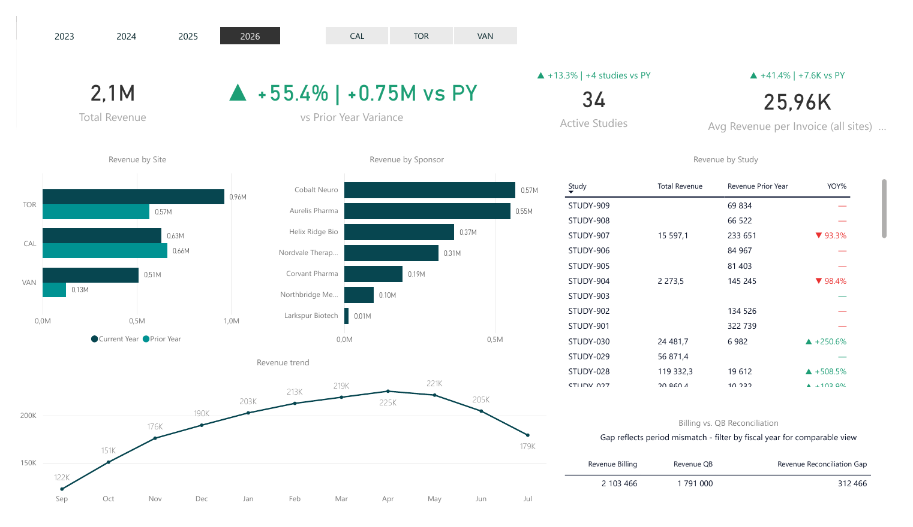
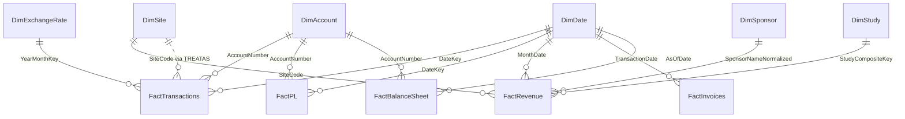
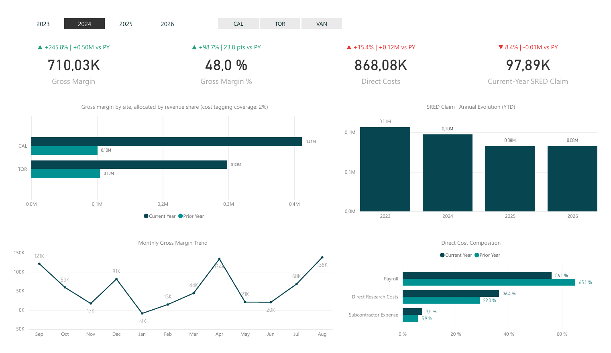
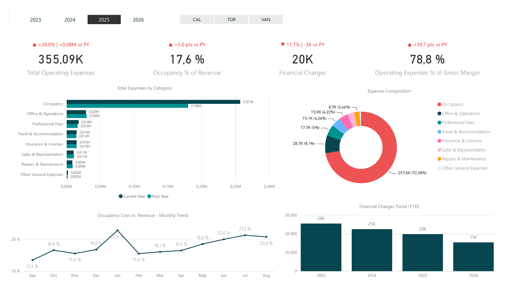
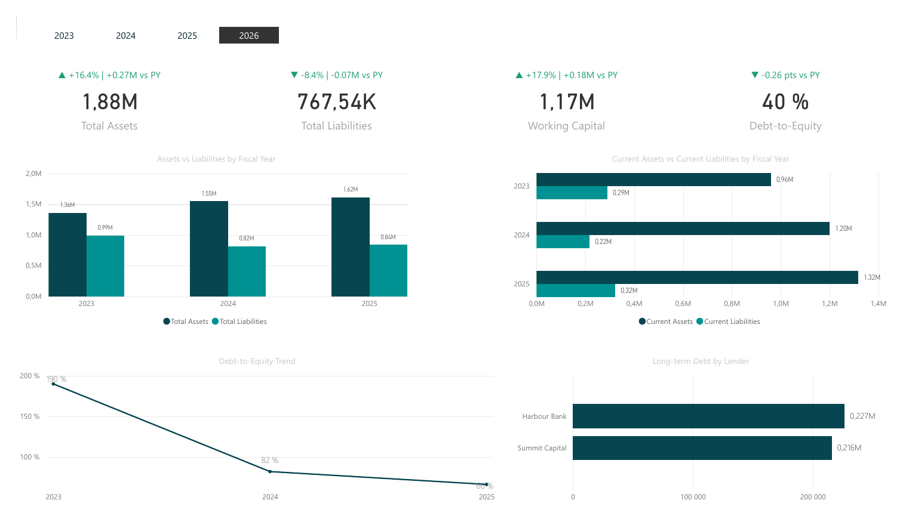
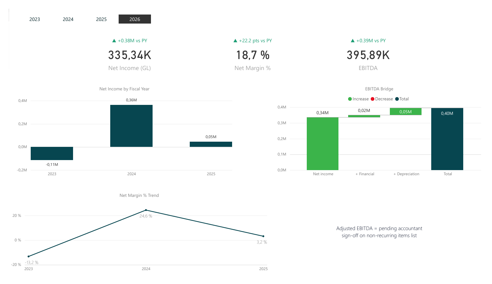

# Financial dashboard on QuickBooks data

Power BI, Power Query (M), DAX, QuickBooks Online exports, fiscal-year time intelligence.

This is a management dashboard for a clinical research company that runs on QuickBooks. It covers revenue by site, sponsor and study, gross margin, operating expenses, net income and EBITDA, and the balance sheet. The fiscal year runs from September to August. Every page compares the selected period with the same period one year earlier.

## My role and impact

I built the model, the Power Query cleaning layer and the report. I also wrote the data quality audit of the company's QuickBooks file that came out of this work.

The production version is refreshed every 24 hours from the QuickBooks Online API, and has been running that way for several months.

> **Data notice.** Every company, clinic, sponsor, study, lender and amount in this repository is fictional. The files in [`data/raw`](data/raw) come from [`data/generate_synthetic_qb_exports.py`](data/generate_synthetic_qb_exports.py) (fixed seed). They copy the layout of real QuickBooks and billing-team exports, including their flaws, so the cleaning queries run on realistic input.
>
> The fictional company is the same one as in the [clinical operations dashboard](https://github.com/sedoalom-djadoo/clinops): same three clinics (Toronto, Calgary, Vancouver), same seven sponsors, same studies. From January 2025 onward, billing revenue per study, clinic and month is built from that project's patient-level data ([`data/source`](data/source)). Older studies (STUDY-901 to 909) predate it.

## Why the Power Query layer matters

QuickBooks exports are built for printing, not for analysis. The queries in this model deal with problems that show up in real files:

| Source | What makes it awkward | How the query handles it |
|---|---|---|
| General ledger (Transaction Detail by Account) | The account appears once as a header row above its transactions, and totals are mixed in with the detail | Tag header rows, fill the account down, keep only dated rows |
| Transaction list by customer | Customer name on its own row, dates stored as US-format text, payments mixed with invoices, USD invoices on a separate A/R account | Fill down, parse dates with `en-US` culture, keep invoices on A/R 12000/12001, flag the currency |
| Billing-team revenue workbooks | One sheet per clinic and year, title rows of varying height, totals and legends inside the data, the same sponsor spelled three ways, typos in protocol codes | Find the header row by looking for `TOTAL`, drop total and legend rows, normalize sponsors and studies, unpivot the months |
| Sponsor mapping | One sponsor can appear under several billing spellings and several QuickBooks customer names, some of them deleted | Deduplicate on the QuickBooks name before joining, otherwise invoices get multiplied |
| Balance sheet | One sheet per year, and "Profit for the year" printed without an account number | Map that line to a technical account (99999) during parsing |
| Chart of accounts | Accounts used in the ledger but missing from the chart | Add them back as "GL-only" so no amount goes uncategorized |

`DimAccount` then groups about 70 QuickBooks accounts into 18 management categories (direct research costs, payroll, occupancy, and so on) and sets the flags the measures rely on: direct cost, SR&ED credit, balance sheet section, current or long-term, lender.

## Data model

Revenue has two sources on purpose. The billing team's workbooks are the only place where revenue is split by clinic, sponsor and study. QuickBooks is the accounting record. The revenue page shows both, along with the gap between them.

## Design choices

### Margins use the accounting figures

Gross margin, net margin and EBITDA are calculated from QuickBooks revenue and costs, so numerator and denominator come from the same system. Billing revenue is used only to split amounts by clinic, sponsor or study.

### Site margin is labeled as an allocation

QuickBooks has a Class field for tagging each transaction with a clinic, but bookkeepers fill it in for only a small share of direct costs. Measuring site margin from tagged costs alone would show every clinic at around 90 %. So the model allocates company gross margin by each clinic's share of billing revenue, and says so in the chart title. The title also shows `Class Tagging Coverage %`. Once that number gets close to 100 %, `Measured Gross Margin by Site` can replace the allocation. It already exists in the model and applies the site filter to the ledger with `TREATAS`, so untagged transactions do not add a (Blank) site to the slicers.

### Prior-year comparisons are like-for-like

The current fiscal year is incomplete. Comparing ten months of this year with twelve months of last year would make every metric look like it dropped. `DimDate[IsBeforeDataCutoff]` marks the dates up to the last ledger transaction, and every prior-year measure shifts only those dates. Balance sheet comparisons work differently: they use the previous fiscal year-end snapshot, because a balance can't be summed over time.

### USD invoices are converted

Invoices on A/R 12001 are in US dollars. Average invoice value converts them with the monthly Bank of Canada rate before averaging.

## Running it locally

1. Clone the repo to `C:\PBI\finops\`. If you use another folder, change the `DataFolder` parameter (Transform data > Manage parameters). It must end with a backslash.
2. Open `FinOps.pbip` in Power BI Desktop and click Refresh.
3. To rebuild the exports, run `python data/generate_synthetic_qb_exports.py`.

The model is saved as TMDL and the report as PBIR, so every query, measure and visual can be read on GitHub.

## Screenshots

Gross margin (FY2024), with the site split shown as an allocation and the tagging coverage in the title

Operating expenses

Balance sheet

Net income and EBITDA

The list of changes made while preparing this public version is in [`docs/CHANGELOG.md`](docs/CHANGELOG.md).

---

Sedoalom Djadoo, Digital Transformation Manager
